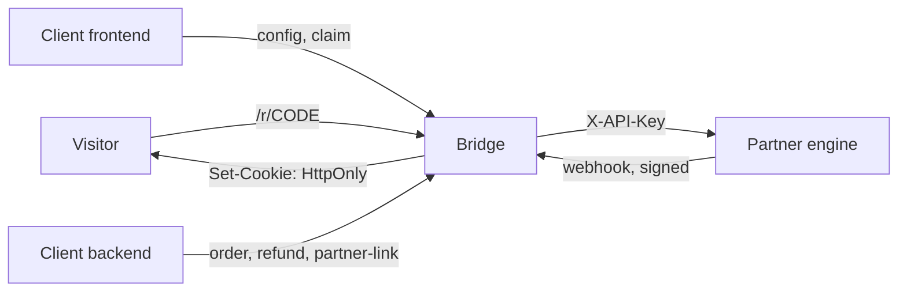

# partna-bridge

Small self-hosted service that sits between a customer's website and the partner-program engine:
it keeps the tenant key on the server, holds the partner binding in an `HttpOnly` cookie, and
receives signed webhooks.

[](https://github.com/partna-dev/partna-bridge/actions/workflows/ci.yml)
[](LICENSE)

## Why a bridge

An integration usually starts with the frontend calling the partner API directly. That works until
someone reads the network tab:

- **The key stays on the server.** `BRIDGE_ENGINE_API_KEY` lives in the bridge environment and never
  reaches the browser.
- **The partner code survives the session.** It is stored in an `HttpOnly` cookie on the customer's
  own domain, not in `sessionStorage` of one tab, so a visitor can close the page and come back to
  a purchase a week later and still be attributed.
- **One public webhook address.** The engine calls the bridge; signature verification and the inbox
  live in one place instead of being spread across the customer's project.

## Architecture



Money never passes through the bridge. It is a proxy with a cookie, a queue and a signature check.

## Quick start

```bash
./scripts/install.sh
```

The script creates `.env`, generates secrets, builds the container, waits for `/health` and prints
what is left to do. Details and checks are in [INSTALL.md](INSTALL.md); agent-oriented notes are in
[AGENTS.md](AGENTS.md).

Until an engine key is set, `/health` reports `key_configured: false` and protected endpoints answer
`503`. That is expected, not a failure.

## Configuration

| Variable | Meaning |
|---|---|
| `BRIDGE_ENGINE_URL` | address of the partner engine |
| `BRIDGE_ENGINE_API_KEY` | tenant key, server-side only |
| `BRIDGE_PUBLIC_URL` | public address of the bridge; the cookie `Secure` flag depends on it |
| `BRIDGE_DESTINATION_URL` | where to send a visitor after `/r/<code>` |
| `BRIDGE_BRIDGE_TOKEN` | bearer token for server-to-server calls: order, refund, partner link |
| `BRIDGE_WEBHOOK_SECRET` | shared secret for webhook signatures |
| `BRIDGE_ALLOWED_ORIGINS` | comma-separated frontend origins allowed by CORS |
| `BRIDGE_COOKIE_DAYS` | binding cookie lifetime, 30 by default |

`BRIDGE_BRAND`, `BRIDGE_CURRENCY` and the outbox settings are documented in [.env.example](.env.example).

## Endpoints

| Endpoint | Caller | Purpose |
|---|---|---|
| `GET /health` | monitoring | alive, is the key configured |
| `GET /v1/config` | frontend | brand, currency, destination address |
| `GET /r/<code>` | visitor | sets the cookie and redirects back with `?ref=<code>` |
| `POST /v1/claim` | frontend | binds the client to a code (from the body or the cookie) |
| `POST /v1/partner-link` | server | partner referral link |
| `POST /v1/order` | server | payment |
| `POST /v1/refund` | server | refund |
| `POST /webhooks/engine` | engine | event delivery, `X-Partner-Signature` |

`order` and `refund` require `Authorization: Bearer <BRIDGE_BRIDGE_TOKEN>`. The frontend must never
call them: otherwise anyone could award themselves a commission.

## Delivery queue

`BRIDGE_OUTBOX_MODE=queue` (default) writes orders and refunds to SQLite and answers `202`; a worker
retries with backoff. `inline` sends immediately and fails loudly when the engine is unreachable.

| Endpoint | Purpose |
|---|---|
| `GET /v1/outbox` | queue entries: status, attempts, error |
| `POST /v1/outbox/{id}/retry` | manual retry |
| `GET /v1/inbox` | accepted webhooks, deduplicated by `eventId` |

## Security model

- The tenant key is used only for outbound calls to the engine.
- The binding cookie is `HttpOnly`, `SameSite=Lax` and gets `Secure` when `BRIDGE_PUBLIC_URL` is
  `https`.
- Webhooks are rejected unless the signature over the raw body matches `BRIDGE_WEBHOOK_SECRET`.
- `claim` is rate-limited to 30 requests per minute per address; beyond that a proxy is expected.
- No personal data is stored: only client identifiers the site already passes.

## Boundaries

- No money is held and no payouts are made here.
- The processed `eventId` list lives in memory: after a restart a repeated event passes again, so the
  host should still deduplicate on its side.
- Not a billing system, not an analytics platform, not a CDN.

## Development

```bash
uv sync --group dev
uv run pytest -q
uv run ruff check src tests
```

The tests cover the parts that actually break in production: the key never appears in responses, the
cookie is set and survives, an order without the bearer token is refused, a webhook with a bad
signature is dropped, and a repeated event is marked as such.

## License

MIT. Русская версия — [README.ru.md](README.ru.md).
