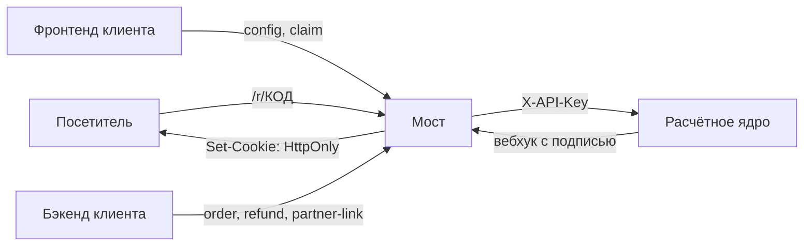

# Мост партнёрской программы

Маленькое приложение, которое ставится на сервере клиента между его сайтом и расчётным ядром. Прячет ключ, держит привязку в cookie и принимает вебхуки.

Английская версия — [README.md](README.md).

## Зачем

- Ключ тенанта живёт в переменных окружения моста, в браузер не попадает.
- Код партнёра хранится в `HttpOnly` cookie на домене сайта, а не в `sessionStorage` вкладки: человек может закрыть страницу и вернуться через неделю.
- Наш вебхук принимает мост: публичный адрес с проверкой подписи один, а не размазан по проекту.

## Схема



Деньги через мост не проходят. Это прокси с cookie, очередью и проверкой подписи.

## Запуск

```bash
./scripts/install.sh
```

Скрипт создаст `.env`, выпустит секреты, соберёт контейнер, дождётся `/health` и напишет, что осталось. Подробности и проверки — в [INSTALL.md](INSTALL.md); для агентов — [AGENTS.md](AGENTS.md).

Если ключ не задан, `/health` вернёт `key_configured: false`, а защищённые методы ответят 503. Это ожидаемо.

## Переменные

| Переменная | Что это |
|---|---|
| `BRIDGE_ENGINE_URL` | адрес расчётного ядра |
| `BRIDGE_ENGINE_API_KEY` | ключ тенанта; только на сервере |
| `BRIDGE_PUBLIC_URL` | публичный адрес моста (от него зависит флаг `Secure` у cookie) |
| `BRIDGE_DESTINATION_URL` | куда возвращать человека после `/r/<код>` |
| `BRIDGE_BRIDGE_TOKEN` | токен для серверных вызовов: заказ, возврат, выдача ссылки |
| `BRIDGE_WEBHOOK_SECRET` | секрет подписи вебхука |
| `BRIDGE_ALLOWED_ORIGINS` | домены фронтенда через запятую, для CORS |
| `BRIDGE_COOKIE_DAYS` | срок жизни cookie привязки, по умолчанию 30 |

## Методы

| Метод | Кто зовёт | Что делает |
|---|---|---|
| `GET /health` | мониторинг | жив ли, настроен ли ключ |
| `GET /v1/config` | фронтенд | бренд, валюта, адрес возврата |
| `GET /r/<код>` | посетитель | ставит cookie и возвращает на сайт с `?ref=<код>` |
| `POST /v1/claim` | фронтенд | привязка клиента к коду (из тела или из cookie) |
| `POST /v1/partner-link` | сервер | ссылка партнёра |
| `POST /v1/order` | сервер | оплата |
| `POST /v1/refund` | сервер | возврат |
| `POST /webhooks/engine` | ядро | приём события с `X-Partner-Signature` |

Заказ и возврат доступны только с `Authorization: Bearer <BRIDGE_BRIDGE_TOKEN>`. Фронтенд их не вызывает: иначе любой желающий сможет начислить комиссию.

## Уровни интеграции

Берите наименьший уровень, который закрывает задачу. Повышать можно позже, не переделывая предыдущий.

| Уровень | Что делает владелец | Файл |
|---|---|---|
| 1 — готовая ссылка | заводит партнёра в кабинете, отправляет ссылку | [level-1-link.md](docs/integrations/level-1-link.md) |
| 2 — своя регистрация | привязывает клиента из бэкенда, показывает ссылку у себя | [level-2-signup.md](docs/integrations/level-2-signup.md) |
| 3 — свой граф | присылает участников из своей CRM | [level-3-own-graph.md](docs/integrations/level-3-own-graph.md) |
| 4 — свои экраны | показывает баланс и выплаты у себя | [level-4-own-screens.md](docs/integrations/level-4-own-screens.md) |

Справка по полям — [docs/integrations/fields.md](docs/integrations/fields.md). Машиночитаемый контракт — `/openapi.json` работающего моста. Проверка уровня — `./scripts/smoke.sh --level 2 --url … --token … --code … --user …`.

## Очередь

`BRIDGE_OUTBOX_MODE=queue` (по умолчанию): заказ и возврат пишутся в SQLite и отвечают 202, воркер досылает с backoff. `inline` отправляет сразу и возвращает ошибку, если ядро недоступно.

| Метод | Что делает |
|---|---|
| `GET /v1/outbox` | очередь: статус, попытки, ошибка |
| `POST /v1/outbox/{id}/retry` | повторить вручную |
| `GET /v1/inbox` | принятые вебхуки, дедуп по `eventId` |

## Безопасность

- Ключ тенанта используется только для исходящих вызовов к ядру.
- Cookie привязки — `HttpOnly`, `SameSite=Lax`, флаг `Secure` ставится, когда `BRIDGE_PUBLIC_URL` начинается с `https`.
- Вебхуки отклоняются, если подпись по сырому телу не сходится с `BRIDGE_WEBHOOK_SECRET`.
- `claim` ограничен 30 запросами в минуту с одного адреса; больше — через внешний прокси.
- Персональных данных нет: только идентификаторы клиентов, которые передаёт сайт.

## Границы

- Мост не хранит деньги и не делает выплат.
- Платёжного провайдера мост не знает: заказ отправляет обработчик вебхука владельца, пример запроса — в [INSTALL.md](INSTALL.md#подключение-к-вебхуку-платёжки).
- Список обработанных `eventId` живёт в памяти: при перезапуске повтор события снова пройдёт. Хост должен дедуплицировать сам, как и раньше.

## Проверка

```bash
uv run pytest -q
uv run ruff check src tests
```

Тесты проверяют главное: ключ не попадает в ответы, cookie ставится и живёт, заказ без токена не проходит, вебхук с плохой подписью отклоняется, повтор события помечается.

## Лицензия

MIT.
